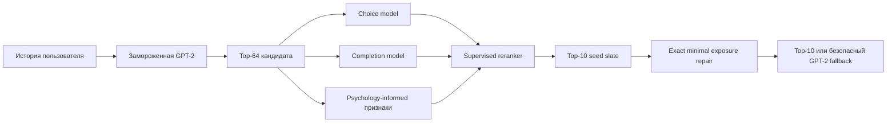

# Psychology-Aware Movie Reranking

**Psychology-informed and constraint-aware reranking of GPT-2 movie recommendations on KION.**

Проект исследует, можно ли улучшить рекомендации фильмов, моделируя не только вероятность следующего выбора, но и ожидаемую глубину просмотра, новизну, повторное потребление, разнообразие, popularity bias и риск выхода за область обучающих данных.

> Главный результат: supervised reranker одновременно улучшил ranking-метрики и несколько поведенческих прокси, но усилил концентрацию показов. Поэтому финальная архитектура отделяет **полезность** от **безопасных ограничений**, а не сворачивает всё в один reward.

## Архитектура



Финальный proposed stage блокирует Top-3/Top-5, разрешает не более 1–2 замен на пользователя и вводит глобальный exposure budget для каждого фильма.

## Что сделано

1. Построен воспроизводимый temporal split без утечки будущего.
2. GPT-2 зафиксирована как генератор Top-64 и baseline ограничений.
3. С нуля обучены CatBoost-модели выбора и ожидаемой завершённости просмотра.
4. Реализованы psychology-informed прокси: completion history, recency, novelty preference, repeat behavior и genre transitions.
5. Сравнены scalar reward RL, constrained reranking, Pareto search и exact post-processing.
6. Добавлены guardrails по NDCG, coverage, Gini, HHI, repeat и OOD.
7. Test финального рекомендательного контура оставлен закрытым во время выбора метода.

## Подтверждённые validation-результаты

Официальная когорта: 5 000 пользователей. Полная таблица находится в [`results/validation_final_comparison.csv`](results/validation_final_comparison.csv).

| Policy | Recall@10 | NDCG@10 | Recall@20 | NDCG@20 | Expected watch | Diversity | Coverage@10 | HHI |
|---|---:|---:|---:|---:|---:|---:|---:|---:|
| GPT-2 | 0.2488 | 0.1452 | 0.3214 | 0.1636 | 0.5338 | 0.6353 | 0.1219 | **0.0260** |
| Supervised reranker | **0.2524** | **0.1470** | **0.3296** | **0.1665** | **0.5366** | **0.6438** | **0.1222** | 0.0283 |

Относительно GPT-2 supervised reranker дал примерно:

- `+1.45%` Recall@10;
- `+1.23%` NDCG@10;
- `+2.55%` Recall@20;
- `+1.79%` NDCG@20;
- `+0.51%` expected watch;
- `+1.33%` intra-list diversity;
- около `−5%` OOD risk;
- repeat proxy снизился до нуля.

Но Exposure HHI ухудшился примерно на `9%`. Поэтому supervised policy — сильный seed slate, а не автоматически безопасная финальная политика.

## Честный статус экспериментов

- Полный constrained optimization увеличивал watch/diversity, но ухудшал NDCG, coverage и exposure.
- Pareto-поиск не нашёл конфигурацию, прошедшую **все** hard guardrails.
- V06 корректно выбрал неизменённый GPT-2 fallback.
- V07 exact minimal repair был запущен, но Colab-сессия завершилась после Stage 1. Финальное улучшение V07 **не заявляется**.
- Нули в `selected_bootstrap_ci.csv` старого запуска означают сравнение GPT-2 с тем же GPT-2 fallback, а не ошибку bootstrap.

Этот отрицательный результат важен: оптимизация model-based watch proxy без глобального контроля может сделать список привлекательнее локально и хуже для каталога в целом.

## Структура

```text
├── artifacts/     # manifest внешнего derived metadata snapshot
├── configs/       # пример путей, параметры и guardrails
├── data/          # инструкция по подготовке закрытых данных
├── docs/          # методология, исследования, история опытов, ограничения
├── models/        # перечень внешних весов
├── notebooks/     # шесть очищенных этапов исследования
├── results/       # компактные подтверждённые validation-артефакты
├── src/           # читаемый feature-store вместо base64-ячеек
└── tests/         # проверки структуры и notebook hygiene
```

## Ноутбуки

| № | Notebook | Назначение |
|---:|---|---|
| 1 | [`01_baseline_evaluation.ipynb`](notebooks/01_baseline_evaluation.ipynb) | frozen GPT-2 baseline |
| 2 | [`02_reward_model.ipynb`](notebooks/02_reward_model.ipynb) | CatBoost watched-percentage model |
| 3 | [`03_psychology_reward_rl.ipynb`](notebooks/03_psychology_reward_rl.ipynb) | scalar reward RL; исследовательский этап |
| 4 | [`04_constrained_reranker.ipynb`](notebooks/04_constrained_reranker.ipynb) | supervised warm start и constrained ablations |
| 5 | [`05_supervised_pareto_top10.ipynb`](notebooks/05_supervised_pareto_top10.ipynb) | Pareto search и global exposure budget |
| 6 | [`06_final_minimal_repair.ipynb`](notebooks/06_final_minimal_repair.ipynb) | proposed exact minimal-edit repair |

Служебные `base64/zlib`-ячейки удалены: общий код находится в `src/`, а внешний metadata-файл описан в `artifacts/manifest.json`. Notebook outputs очищены, чтобы Git показывал код, а не устаревшие Colab-логи.

## Быстрый старт

```bash
git clone https://github.com/rddiana/psychology-aware-movie-reranking.git
cd psychology-aware-movie-reranking
python -m venv .venv
# Linux/macOS: source .venv/bin/activate
# Windows: .venv\Scripts\activate
pip install -r requirements.txt
cp configs/paths.example.yaml configs/paths.yaml
jupyter notebook
```

Положите данные и веса по схемам из [`data/README.md`](data/README.md) и [`models/README.md`](models/README.md). Для полной истории запускайте ноутбуки последовательно. Для продолжения финального опыта нужны сохранённые supervised artifacts и `06_final_minimal_repair.ipynb`.

## Научная основа

- [Non-compensatory decision making for movie choice](https://cau.scholarworks.kr/item/54c55e7e-0a00-474d-b777-3ee64717b837) — мотивирует пороговые правила и guardrails.
- [The Influence of Online Ratings on Film Choice](https://doaj.org/article/a8adc400f6524cb99f5c45380962f84d) — роль social signals и популярности.
- [Computationally modeling mood management theory](https://doi.org/10.1093/joc/jqad020) — контекст выбора медиаконтента и осторожное использование behavioral proxies.
- [A survey on popularity bias in recommender systems](https://link.springer.com/article/10.1007/s11257-024-09406-0) — exposure concentration и feedback loops.

Подробнее: [`docs/research_background.md`](docs/research_background.md).

## Ограничения

Психологические переменные здесь являются прокси, а не прямым измерением настроения. Expected watch — offline model estimate. Impression propensities отсутствуют. Финальные выводы требуют одноразовой test-оценки после фиксации конфигурации и, в идеале, онлайн A/B-теста. Полный список — в [`docs/limitations.md`](docs/limitations.md).

## Автор

**Diana Rekunova** · [GitHub](https://github.com/rddiana)

## License

MIT License. Датасет KION и внешние веса сохраняют собственные условия использования и не входят в репозиторий.
